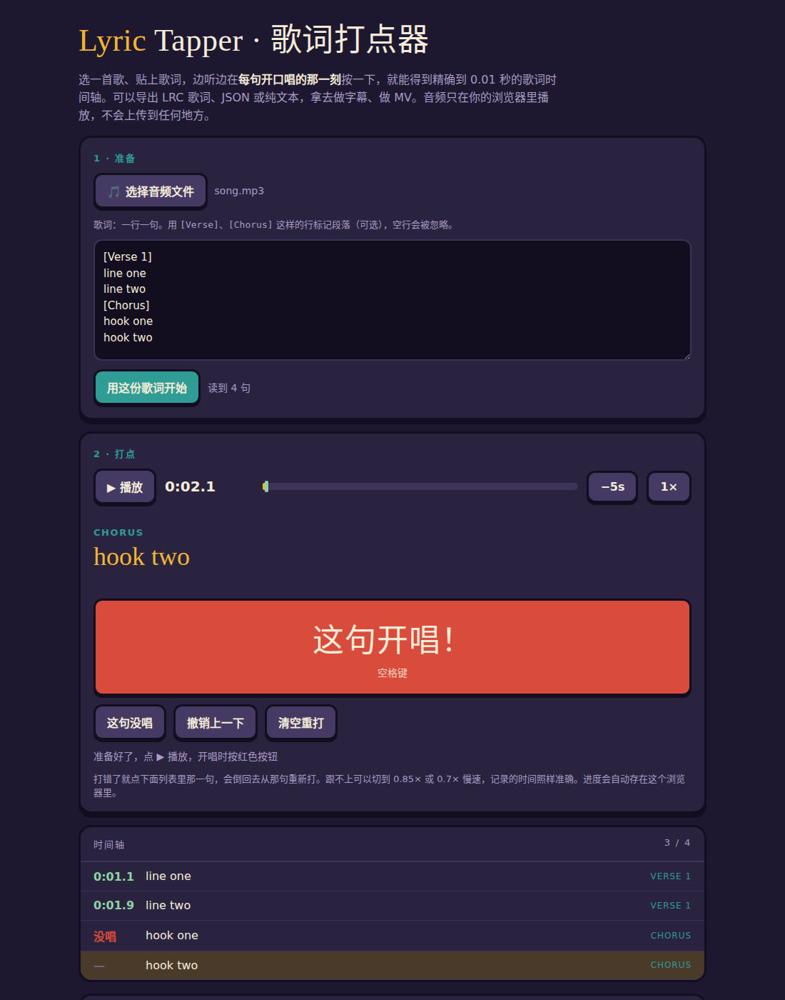

# Lyric Tapper · 歌词打点器

边听歌边在每句开唱时点一下，得到精确到 0.01 秒的歌词时间轴。
导出 LRC 歌词、JSON 或纯文本，拿去做字幕、卡拉OK、MV。

**在线使用：https://caiziqiczq.github.io/lyric-tapper/**

## 怎么用

1. **选歌**：点「选择音频文件」，mp3 / m4a / wav 都行。音频只在你的浏览器里播放，不会上传到任何地方。
2. **贴歌词**：一行一句。可以用 `[Verse]`、`[Chorus]` 这样单独一行标记段落，空行会被忽略。点「用这份歌词开始」。
3. **打点**：点 ▶ 播放，每句**开口唱的那一刻**按红色按钮，电脑上按空格键也行。
   - 这句歌手没唱：点「这句没唱」
   - 按错了：点列表里那一句，会倒回去从那句重新打
   - 跟不上：切到 0.85× 或 0.7× 慢速，记录的时间照样准确
4. **导出**：选格式，复制或下载。

进度会自动存在当前浏览器里，同一首歌、同一份歌词下次打开会接着上次的进度。

## 导出格式

| 格式 | 样子 | 适合 |
| --- | --- | --- |
| 文本 | `12.35	歌词` | 直接发给 AI，让它按时间轴做字幕或动画 |
| LRC | `[00:12.35]歌词` | 音乐播放器、剪映等剪辑软件的歌词字幕 |
| JSON | `{"text": "...", "start": 12.35}` | 写代码用 |

## 来历

这是做 [Who's the Realest One? 代码 MV](https://github.com/Caiziqiczq/realest-one-mv) 时给字幕对时间轴用的小工具，后来改成了任何歌都能用的通用版。

单个 HTML 文件，没有依赖，下载 `index.html` 双击打开也能用。
